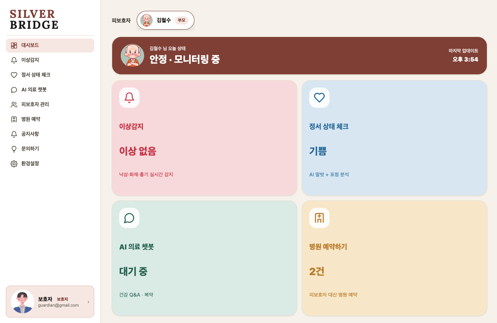
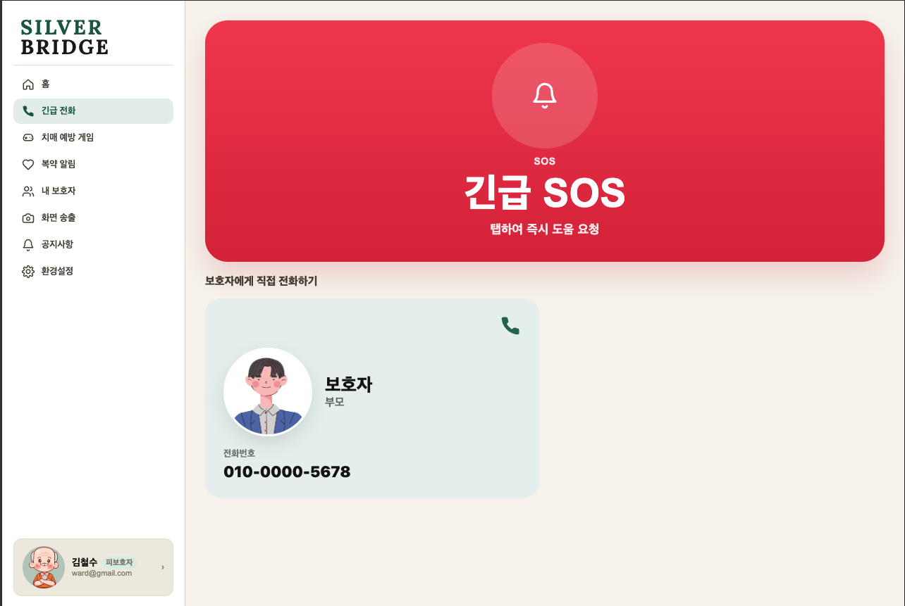
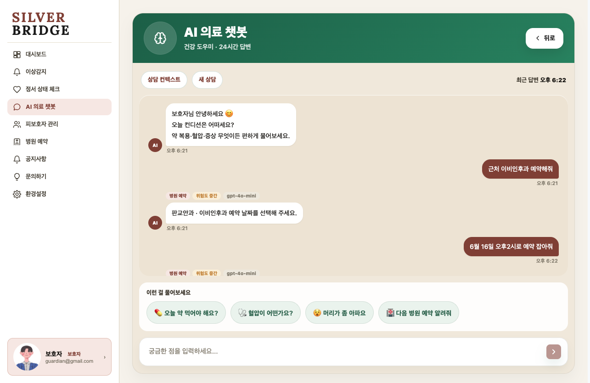
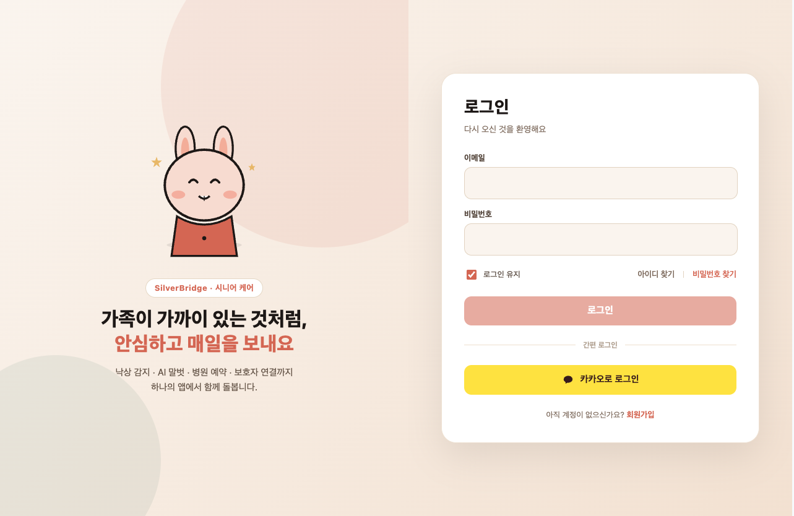

# SilverBridge FE

보호자와 피보호자(어르신)를 연결하는 AI 케어 플랫폼 **SilverBridge**의 프론트엔드입니다.

Next.js App Router 기반 웹 애플리케이션으로, 로그인한 사용자의 역할(보호자 `GUARDIAN` · 피보호자 `WARD` · 관리자 `ADMIN`)에 따라 화면과 라우트를 분리합니다.



## 주요 기능

### 피보호자 (`/ward`)

- 긴급 전화(SOS) — 보호자·119 바로 걸기
- 내 가족 — 보호자 연결 요청 수락·해제, 프로필 ID 공유
- 카메라 등록 및 실시간 영상 송출
- 복약 알림, 병원 예약 확인
- 공지사항, 알림·보안 설정



### 보호자 (`/guardian`)

- 대시보드 — 연결된 가족의 상태를 한눈에 확인
- 이상감지 모니터링 (화재·흉기·낙상) 및 SOS 이력
- 정서 상태 체크
- AI 의료 챗봇 (응급 증상 안내·병원 예약·일반 문의)
- 복약 관리, 병원 예약
- 가족 등록(링크 공유)·연결 관리
- 공지사항, 문의하기, 환경설정



### 관리자 (`/admin`)

- 운영 대시보드 — AI 서비스 상태, 오늘의 이상감지·카메라 현황
- 회원 관리, AI 통계(이상감지 판정·챗봇 사용량), 알림 이력
- 디바이스(카메라) 관리, 제휴 병원 관리
- 공지사항 작성, 고객센터(문의 답변)

### 공통

- 이메일 로그인 / 카카오 로그인, 회원가입, SMS 인증, 이메일·비밀번호 찾기
- Access/Refresh Token 재발급과 세션 복원, 역할별 라우트 가드
- 프로필 수정·이미지 업로드, 비밀번호 변경, 회원 탈퇴
- WebSocket(STOMP) 실시간 알림, FCM 웹 푸시



## 기술 스택

| 구분         | 기술                                      |
| ------------ | ----------------------------------------- |
| Framework    | Next.js 16 (App Router), React 19         |
| Language     | TypeScript                                |
| Styling      | CSS Modules, classnames                   |
| Server State | TanStack Query                            |
| Client State | 자체 store (`src/store`)                  |
| API Client   | Axios + Next.js API proxy route           |
| Realtime     | STOMP WebSocket, Firebase Cloud Messaging |
| Form         | react-hook-form                           |
| Date         | dayjs                                     |
| Test         | Vitest (node / Chrome 브라우저 모드)      |
| Deploy       | Docker, Docker Compose                    |

## 폴더 구조

```text
src
├── app
│   ├── (auth)        # 로그인, 회원가입, 이메일/비밀번호 찾기, 카카오 콜백
│   ├── (ward)        # 피보호자 페이지
│   ├── (guardian)    # 보호자 페이지
│   ├── (admin)       # 관리자 페이지
│   ├── api           # 백엔드·스트림·예약 API 프록시, 카카오 OAuth
│   └── oauth         # OAuth 진입 페이지
├── assets            # SVG 아이콘
├── components        # 공용 컴포넌트 (layout, chatbot, settings 등)
├── constants         # 메뉴·패턴 등 상수
├── hooks             # 공용 React 훅
├── lib               # API client, 인증, 실시간(STOMP), FCM, 카카오, 서버 전용 설정
├── service
│   ├── api           # 서버 API 함수
│   ├── interface     # API 요청/응답 타입
│   └── query         # TanStack Query 훅
├── store             # 모달·토스트 상태
├── types             # 전역 타입 선언
└── utils             # 도메인별 유틸 (dashboard, medication, reservation 등)
docs                  # 기능별 설계·점검 문서와 화면 캡처
```

### API 프록시

브라우저는 백엔드를 직접 호출하지 않고 Next.js route handler를 거칩니다.

| 경로                              | 대상                                                    |
| --------------------------------- | ------------------------------------------------------- |
| `/api/[...path]`                  | 메인 백엔드 (`NEXT_PUBLIC_API_DOMAIN`), 쿠키 토큰 주입 |
| `/api/streams/[...path]`          | 영상 스트림 서버 (`NEXT_PUBLIC_AI_API_DOMAIN`)          |
| `/api/reservation/[...path]`      | 병원 예약 API (`RESERVATION_API_URL`)                   |
| `/api/oauth/kakao/authorize`      | 카카오 인가 URL 생성                                    |

## 시작하기

### 1. 의존성 설치

```bash
npm install
```

### 2. 환경 변수 설정

`.env.local`(로컬) 또는 `.env.dev`(개발 서버 Docker)에 값을 설정합니다. `.env*` 파일은 커밋하지 않습니다.

| 변수                                  | 설명                                         |
| ------------------------------------- | -------------------------------------------- |
| `NEXT_PUBLIC_API_DOMAIN`              | 메인 백엔드 API 도메인                       |
| `NEXT_PUBLIC_WS_URL`                  | WebSocket(STOMP) 주소 (생략 시 기본 주소 사용)  |
| `NEXT_PUBLIC_AI_API_DOMAIN`           | AI·영상 스트림 서버 도메인                   |
| `STREAM_API_KEY`                      | 스트림 서버 API 키 (서버 전용)               |
| `RESERVATION_API_URL`                 | 병원 예약 API 주소 (서버 전용)               |
| `NEXT_PUBLIC_KAKAO_CLIENT_ID`         | 카카오 REST API 키                           |
| `NEXT_PUBLIC_KAKAO_REDIRECT_URI`      | 카카오 OAuth redirect URI                    |
| `KAKAO_REST_API_KEY`                  | 카카오 REST API 키 (서버 전용, 우선 적용)    |
| `KAKAO_REDIRECT_URI`                  | 카카오 OAuth redirect URI (서버 전용)        |
| `NEXT_PUBLIC_KAKAO_JAVASCRIPT_API_KEY`| 카카오톡 공유용 JavaScript 키                |
| `NEXT_PUBLIC_FIREBASE_*`              | FCM 설정 (`API_KEY`, `APP_ID`, `SENDER_ID`, `VAPID_KEY`) |
| `ALLOWED_DEV_ORIGINS`                 | 개발 서버 외부 접속 허용 origin (쉼표 구분)  |

> `NEXT_PUBLIC_*` 값은 빌드 시 클라이언트 번들에 포함되므로, 값을 바꾸면 다시 빌드해야 합니다.

### 3. 개발 서버 실행

```bash
npm run dev   # http://localhost:6510
```

### 4. 빌드 / 프로덕션 실행

```bash
npm run build
npm run start
```

### 5. 린트 / 테스트

```bash
npm run lint
npm test              # 단위 테스트 (node 환경, *.test.ts)
npm run test:browser  # 컴포넌트 테스트 (*.browser.test.tsx)
```

`test:browser`는 PC에 설치된 Google Chrome을 그대로 사용하며, 브라우저를 따로 내려받지 않습니다. Chrome이 없으면 실행되지 않습니다.

## Docker 배포

두 환경 모두 컨테이너 포트를 호스트 루프백에만 열고, 같은 호스트의 nginx가 프록시합니다. 예약 API와 통신하기 위해 외부 네트워크 `sb-internal`이 필요합니다.

```bash
docker network create sb-internal   # 최초 1회
```

| 환경 | 명령                                                                          | 호스트 포트 |
| ---- | ----------------------------------------------------------------------------- | ----------- |
| 개발 | `docker compose -f docker-compose.dev.yml up -d`                              | `6510`      |
| 운영 | `docker compose --env-file .env.prod -f docker-compose.prod.yml up -d --build` | `6010`      |

- 개발: `next dev`를 컨테이너에서 실행하며 소스를 볼륨으로 마운트합니다. 환경 변수는 `.env.dev`에서 읽습니다.
- 운영: `Dockerfile` 멀티 스테이지 빌드. `NEXT_PUBLIC_*` 값은 `.env.prod`에서 build arg로 전달됩니다.
