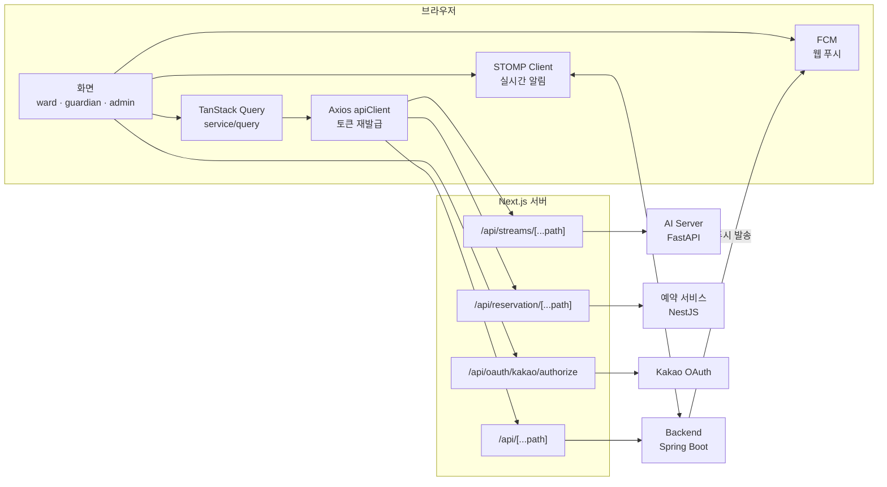

# 🌉 SilverBridge FE

**CareAI 프론트엔드** — 어르신(피보호자) · 보호자 · 관리자가 각자 필요한 돌봄 기능을 바로 쓰는 웹 애플리케이션

      

[](https://devdmu.gosky.kr) [](https://www.youtube.com/watch?v=y4lUm_REdXM)

---

## 1. 프로젝트 소개

CareAI는 독거노인을 위한 **AI 기반 통합 케어 플랫폼**입니다. 실시간 영상 AI가 위험을 감지하고, AI 의료 챗봇이 상담부터 병원 예약까지 돕고, AI 말벗이 일상의 외로움을 덜어 줍니다.

이 저장소는 그중 **웹 프론트엔드**입니다. 로그인한 사용자의 역할에 따라 화면과 라우트를 나눠, 같은 서비스라도 각자에게 맞는 화면을 보여 줍니다.

| 역할 | 경로 | 화면 성격 |
| --- | --- | --- |
| 👵 피보호자 `WARD` | `/ward` | 큰 버튼 · 단순한 흐름 — SOS, 복약, 카메라 송출 중심 |
| 👨‍👩‍👧 보호자 `GUARDIAN` | `/guardian` | 대시보드 — 이상감지 모니터링, 챗봇, 예약, 가족 관리 |
| 🛠️ 관리자 `ADMIN` | `/admin` | 운영 콘솔 — 회원·디바이스·AI 통계·공지·문의 관리 |

| | |
|:---:|:---:|
| <br/>**피보호자 · 메인 화면** | <br/>**보호자 · 대시보드** |

---

## 2. 화면별 기능

### 2.1 AI 이상 감지 · 긴급 SOS

**위험은 AI가 먼저 보고, 가족은 바로 압니다.**

- 🆘 **긴급 전화(SOS)** — 피보호자가 버튼 하나로 보호자·119에 연락
- 🔔 **실시간 이상감지 알림** — 화재·흉기·낙상 감지 시 STOMP WebSocket과 웹 푸시로 즉시 알림
- 🎥 **감지 영상 확인** — 보호자가 감지 장면을 확인하고 실제 위험/오탐을 판정
- 📋 **SOS 이력** — 보호자 화면에서 호출 기록 조회

| | |
|:---:|:---:|
| <br/>**피보호자 · SOS 호출** | <br/>**보호자 · SOS 수신** |
| <br/>**보호자 · 이상 감지 목록** | <br/>**보호자 · 이상 감지 영상 확인** |

### 2.2 카메라 등록 · 실시간 송출

- 피보호자 기기의 카메라를 등록하고, 브라우저에서 바로 영상을 송출
- 송출 영상은 AI 서버로 전달되어 이상감지에 사용
- 스트림 API는 Next.js 프록시(`/api/streams`)를 거쳐 API 키를 브라우저에 노출하지 않음

| | |
|:---:|:---:|
| <br/>**피보호자 · 카메라 등록** | <br/>**피보호자 · 카메라 송출 중** |

### 2.3 AI 의료 챗봇 · 병원 예약

**아플 때, 묻는 순간 답이 옵니다.**

| 모드 | 역할 |
|---|---|
| 🚨 응급 증상 | 증상을 분석하고 적절한 대응을 안내 |
| 🗓️ 병원 예약 | 병원 검색 및 예약 대화 지원 |
| 💬 일반 문의 | 의료 관련 궁금증에 답변 |

```text
증상 말하기 → AI가 정리 → 병원 찾기 → 바로 예약
```

- 챗봇 대화 중 예약 카드·추천 질문 등 UI 프롬프트를 채팅 안에서 바로 처리
- 보호자가 연결된 가족을 골라 대신 예약 가능, 피보호자는 예약 현황 확인

| | |
|:---:|:---:|
| <br/>**AI 의료 챗봇** | <br/>**병원 검색 · 예약** |
| <br/>**피보호자 · 예약 현황** | |

### 2.4 복약 알림 · 치매 예방 · 정서 체크

**약 한 알, 게임 한 판. 매일이 쌓여 건강이 됩니다.**

- 피보호자는 복약 체크만, 기록은 보호자 화면에 자동으로 쌓임
- 보호자는 복약 일정 등록·수정 및 복약 현황 관리
- 치매 예방 두뇌 게임 — 카드 짝 맞추기 · 빈칸 채우기 · 더하기 · 빼기
- 정서 상태 체크 🔄 개발 중 — AI 말벗 대화와 표정으로 분석한 마음 상태를 보호자에게 표시

| | |
|:---:|:---:|
| <br/>**피보호자 · 복약** | <br/>**보호자 · 복약 관리** |
| <br/>**피보호자 · 치매 예방 게임** | <br/>**보호자 · 정서 상태 체크** |

### 2.5 가족 연결

- 보호자가 피보호자 ID 또는 **가족 등록 링크**로 연결 요청 (카카오톡 공유 지원)
- 링크로 들어오면 ID가 미리 채워지고, 로그인 후 원래 화면으로 복귀
- 피보호자가 요청을 수락·거절하고, 연결된 보호자 목록 관리

| | |
|:---:|:---:|
| <br/>**보호자 · 피보호자 연결** | <br/>**피보호자 · 내 보호자** |

### 2.6 관리자 콘솔

- **대시보드** — AI 서비스 상태, 오늘의 이상감지 유형별 현황, 카메라 켜짐/꺼짐
- **회원 관리** — 역할별(보호자·피보호자·관리자) 회원 조회
- **AI 통계** — 이상감지 판정(위험·오탐·미판정) 및 AI 오탐률, 챗봇 사용량
- **알림 이력 · 디바이스 관리 · 제휴 병원** — 운영 현황 확인
- **공지사항 · 고객센터** — 공지 작성, 사용자 문의 답변

| | |
|:---:|:---:|
| <br/>**관리자 · 대시보드** | <br/>**관리자 · AI 통계** |
| <br/>**관리자 · 회원 관리** | <br/>**관리자 · 디바이스 관리** |

### 2.7 로그인 · 인증 · 알림 설정

**시니어도 보호자도 막힘없이 시작**

- **이메일 · 카카오 소셜 로그인**, 회원가입, SMS 인증, 이메일·비밀번호 찾기
- **역할별 라우트 가드** — 역할에 맞지 않는 화면 접근 시 자동으로 돌려보냄
- **세션 유지** — Access/Refresh Token 자동 재발급, 새로고침 시 세션 복원
- **알림 설정** — 알림 유형별로 웹 푸시·SMS·이메일·카카오 알림톡 채널 선택
- **마이페이지** — 프로필·이미지 수정, 비밀번호 변경, 회원 탈퇴

| | |
|:---:|:---:|
| <br/>**로그인** | <br/>**회원가입** |
| <br/>**보호자 · 알림 환경설정** | <br/>**공지사항** |

---

## 3. 프론트엔드 구조

브라우저는 백엔드를 직접 호출하지 않고 **Next.js Route Handler(프록시)** 를 거칩니다. 토큰은 쿠키에서 꺼내 서버 쪽에서 주입하고, 서버 전용 키(스트림·카카오·예약)는 브라우저에 노출되지 않습니다.



| 프록시 경로 | 대상 |
| --- | --- |
| `/api/[...path]` | 메인 백엔드 (`NEXT_PUBLIC_API_DOMAIN`), 쿠키 토큰 주입 |
| `/api/streams/[...path]` | 영상 스트림 서버 (`NEXT_PUBLIC_AI_API_DOMAIN` + `STREAM_API_KEY`) |
| `/api/reservation/[...path]` | 병원 예약 API (`RESERVATION_API_URL`) |
| `/api/oauth/kakao/authorize` | 카카오 인가 URL 생성 |

---

## 4. 기술 스택

| 분류 | 기술 |
| --- | --- |
| **Framework** | Next.js 16 (App Router), React 19 |
| **Language** | TypeScript |
| **Styling** | CSS Modules, classnames |
| **Server State** | TanStack Query |
| **API Client** | Axios + Next.js Route Handler 프록시 |
| **Realtime** | STOMP WebSocket, Firebase Cloud Messaging |
| **Form · Date** | react-hook-form, dayjs |
| **Test** | Vitest (node 단위 테스트 · Chrome 브라우저 컴포넌트 테스트) |
| **DevOps** | Docker, Docker Compose, Nginx |

---

## 5. 폴더 구조

```text
src
├── app
│   ├── (auth)        # 로그인, 회원가입, 이메일/비밀번호 찾기, 카카오 콜백
│   ├── (ward)        # 피보호자 페이지
│   ├── (guardian)    # 보호자 페이지
│   ├── (admin)       # 관리자 페이지
│   ├── api           # 백엔드·스트림·예약 API 프록시, 카카오 OAuth
│   └── oauth         # OAuth 진입 페이지
├── assets            # SVG 아이콘
├── components        # 공용 컴포넌트 (layout, chatbot, settings 등)
├── constants         # 메뉴·패턴 등 상수
├── hooks             # 공용 React 훅
├── lib               # API client, 인증, 실시간(STOMP), FCM, 카카오, 서버 전용 설정
├── service
│   ├── api           # 서버 API 함수
│   ├── interface     # API 요청/응답 타입
│   └── query         # TanStack Query 훅
├── store             # 모달·토스트 상태
├── types             # 전역 타입 선언
└── utils             # 도메인별 유틸 (dashboard, medication, reservation 등)
docs                  # 기능별 설계·점검 문서와 화면 캡처
```

---

## 6. 시작하기

### 6.1 의존성 설치

```bash
npm install
```

### 6.2 환경 변수

`.env.local`(로컬) 또는 `.env.dev`(개발 서버 Docker)에 값을 설정합니다. `.env*` 파일은 커밋하지 않습니다.

| 변수 | 설명 |
| --- | --- |
| `NEXT_PUBLIC_API_DOMAIN` | 메인 백엔드 API 도메인 |
| `NEXT_PUBLIC_WS_URL` | WebSocket(STOMP) 주소 (생략 시 기본 주소 사용) |
| `NEXT_PUBLIC_AI_API_DOMAIN` | AI·영상 스트림 서버 도메인 |
| `STREAM_API_KEY` | 스트림 서버 API 키 (서버 전용) |
| `RESERVATION_API_URL` | 병원 예약 API 주소 (서버 전용) |
| `NEXT_PUBLIC_KAKAO_CLIENT_ID` | 카카오 REST API 키 |
| `NEXT_PUBLIC_KAKAO_REDIRECT_URI` | 카카오 OAuth redirect URI |
| `KAKAO_REST_API_KEY` | 카카오 REST API 키 (서버 전용, 우선 적용) |
| `KAKAO_REDIRECT_URI` | 카카오 OAuth redirect URI (서버 전용) |
| `NEXT_PUBLIC_KAKAO_JAVASCRIPT_API_KEY` | 카카오톡 공유용 JavaScript 키 |
| `NEXT_PUBLIC_FIREBASE_*` | FCM 설정 (`API_KEY`, `APP_ID`, `SENDER_ID`, `VAPID_KEY`) |
| `ALLOWED_DEV_ORIGINS` | 개발 서버 외부 접속 허용 origin (쉼표 구분) |

> `NEXT_PUBLIC_*` 값은 빌드 시 클라이언트 번들에 포함되므로, 값을 바꾸면 다시 빌드해야 합니다.

### 6.3 실행

```bash
npm run dev     # 개발 서버 → http://localhost:6510
npm run build   # 프로덕션 빌드
npm run start   # 프로덕션 실행
```

### 6.4 린트 · 테스트

```bash
npm run lint
npm test              # 단위 테스트 (node 환경, *.test.ts)
npm run test:browser  # 컴포넌트 테스트 (*.browser.test.tsx)
```

`test:browser`는 PC에 설치된 Google Chrome을 그대로 사용하며, 브라우저를 따로 내려받지 않습니다. Chrome이 없으면 실행되지 않습니다.

---

## 7. 배포

두 환경 모두 컨테이너 포트를 호스트 루프백에만 열고, 같은 호스트의 Nginx가 프록시합니다. 예약 API와 통신하기 위해 외부 네트워크 `sb-internal`이 필요합니다.

```bash
docker network create sb-internal   # 최초 1회
```

| 환경 | 도메인 | 명령 | 호스트 포트 |
| --- | --- | --- | :---: |
| 개발 | devdmu.gosky.kr | `docker compose -f docker-compose.dev.yml up -d` | `6510` |
| 운영 | dmu.gosky.kr | `docker compose --env-file .env.prod -f docker-compose.prod.yml up -d --build` | `6010` |

- **개발** — 컨테이너에서 `next dev`를 실행하고 소스를 볼륨으로 마운트합니다. 환경 변수는 `.env.dev`에서 읽습니다.
- **운영** — `Dockerfile` 멀티 스테이지 빌드. `NEXT_PUBLIC_*` 값은 `.env.prod`에서 build arg로 전달됩니다.

---

## 8. 팀 구성

동양미래대학교 · 지도교수 **이희진** 교수님

| 이름 | 역할 |
| --- | --- |
| 이하늘 | **팀장** · PM · 인프라 |
| 남궁명진 | **백엔드** |
| 이재희 | **AI 엔지니어** |
| 이윤아 | **프론트엔드** |

---

## 9. 관련 저장소

| 저장소 | 설명 |
| --- | --- |
| [SilverBridgeFe](https://github.com/Dongyang-Mirae-University-software/SilverBridgeFe) | Next.js 프론트엔드 (현재 저장소) |
| [SilverBridgeBe](https://github.com/Dongyang-Mirae-University-software/SilverBridgeBe) | Spring Boot 백엔드 |
| [SilverBridgeAiServer](https://github.com/Dongyang-Mirae-University-software/SilverBridgeAiServer) | AI 서버 (이상감지·의료 챗봇·인지훈련 게임) |
| [AiSilverBridgeSky](https://github.com/Dongyang-Mirae-University-software/AiSilverBridgeSky) | YOLO 이상감지 모델 학습·추론 서비스 |
| [ChatSilverBridge](https://github.com/Dongyang-Mirae-University-software/ChatSilverBridge) | MedGemma 의료 챗봇 서버 |
| [SilverBridgeReservation](https://github.com/Dongyang-Mirae-University-software/SilverBridgeReservation) | 병원 예약 서비스 (NestJS) |
| [SilverBridgeQA](https://github.com/Dongyang-Mirae-University-software/SilverBridgeQA) | 실제 화면 E2E QA 자동화 (Playwright) |
